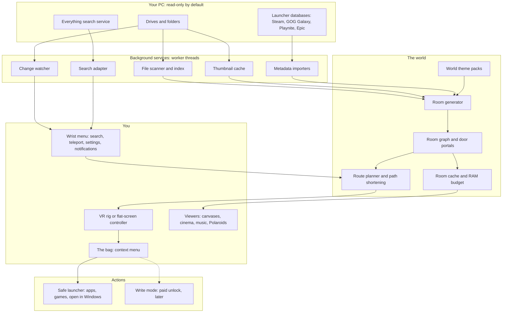

# Project Snow Crash: Design Overview

*Drafted 11 Oct 2026 from Bit's decisions in `../VR_FILE_EXPLORER.md`. Working title only (see OPEN_QUESTIONS.md about the name).*

## The one-line pitch

**Walk through your own computer.** Snow Crash turns "This PC" into a place you can stroll around in VR or on a flat screen: drives become buildings, folders become rooms, and your files become the things in those rooms. Pictures hang on the walls, films play in a little cinema, games sit in their cases on shop shelves. It's a file explorer first, with just a light sprinkle of game.

## What it is (and isn't)

| It is | It isn't |
|---|---|
| A real, useful file explorer you can walk around | A game with a file browser bolted on |
| Lightly gamified: loot drops, a bag, themed worlds | A grind, a score, or a shop |
| Read-only and safe by default | Something that can break your PC from a headset |
| Pointing at your real files where they already live | A tool that copies, uploads or "imports" anything |
| Private by default | A social network that shares your stuff |
| Open source, with Bit as maintainer and final say | A free-for-all with no direction |

## Design pillars

1. **It's your file system, made walkable.** Every room is a real folder; every object is a real file. If it exists on disk you can find it, and if it's in the world it exists on disk. No fake content (except the tutorial).
2. **Bite-sized rooms, always.** No room should ever show more than a person can comfortably take in. Big folders become one calm room with a sensible number of canvases that cycle, never an endless wall or a maze of 40 near-identical rooms.
3. **Safe by default.** Free mode is read-only. Nothing in the world can move, rename or delete a file unless write mode has been unlocked *and* the user asks for it explicitly. Windows permissions always apply.
4. **Fast enough to feel like a place.** Rooms load before you get there, reset when you leave, and the RAM budget is the user's call. A file explorer you have to wait for is worse than Explorer.
5. **Comfortable for everyone.** Seated, standing, treadmill or flat-screen WASD; snap turn and vignettes; a bare low-power world as the default. Nobody should feel sick or lost.
6. **Private until you say otherwise.** Guests see nothing until you open a door for them. We never monitor anyone's own PC.
7. **A little bit Snow Crash.** The Street, the Port, the loot drops, messenger easter eggs one day. Flavour, never friction.

## The core mapping

| Real thing | In the world |
|---|---|
| This PC | The world (bare background, or one of the 4 stock worlds) |
| Drive (C:, D:, E:) | A building (or island, museum hall, mansion wing, depending on the world) |
| Folder | A room |
| Subfolder | A labelled door in the room (folder name + thumbnail). Impossible space is fine: doors don't have to make architectural sense |
| Image | A picture on the wall; big folders = N canvases each cycling through its share |
| Video | A cinema (sit down first, then Play) or a living-room TV; films resume |
| Game | A case on a shelf, grouped by platform, with real box art |
| App | A "use this" button/plaque on the wall (or a case/icon on an app shelf) |
| Unknown file | A themed object (crate, chest, filing cabinet) or a colour-coded spinning loot drop |
| Image we can't decode | A Polaroid |
| Right-click menu | **The bag**: pick something up and the bag opens with its options |

## How you get around

- **Walk** (smooth locomotion, teleport arcs, treadmill, or WASD).
- **Teleport menu** on the wrist: pick a drive to land at its front door, or a folder to drop straight into that room.
- **Search** (powered by Everything where installed): teleport to a result, grab it into the bag, or take a **guided walk** where the world quietly reshapes behind you to shorten the route (toggle off if you prefer the "real" route).
- **Notifications** on the wrist panel when files change ("New file in Downloads: view / go there / ignore").

## The systems at a glance

## The big phases (detail in ROADMAP.md)

1. **Demo:** one building in the install-folder world, a short tutorial, a manual setup wizard ("where are your movies, pictures, games?"), pictures on walls and one cinema. Bit's first real test: her webrips folder.
2. **Alpha on GitHub:** the full walkable explorer (drives as buildings, search, teleport, bag, launcher metadata, bare world + first stock world).
3. **Shared workspaces:** invite people into a purpose-built room; files streamed from the host or a shared cloud folder; simple avatars; recorded only with clear consent.
4. **Social lobby (only if possible):** a small, casual PlayStation Home-style hangout. Never 256 people shouting.
5. **Steam release.**

Parked for later: acting as a Second Life / OpenSim viewer, a standalone Quest build, messenger characters, live previews through doors.

## Who it's for

- **Bit first:** a big media collection (webrips, films, emulated games across PSX/PS2/Xbox/360 and a 512-game PC wall) she wants to actually *enjoy* browsing.
- **Collectors and archivists** with huge picture, film and game libraries.
- **VR people** who'd like their headset to be useful for something calm.
- **Later, small teams** who want a shared room to look at the same files together.

## The demo test that matters

> Bit puts on her Quest 2, opens Snow Crash, points the wizard at her webrips folder, and within a minute is walking through a gallery wing of a site she saved, then sits down in its cinema and picks a video from a thumbnail wall. "It could be that simple."

If that moment works and feels good, the project is on track.

## Companion documents

- TECH_ARCHITECTURE.md: how it's built
- ROOM_TYPES.md: every file type and what the bag offers
- WORLDS.md: the bare default, the four stock worlds, and the World SDK
- UX_CONTROLS.md: controls, menus, comfort and accessibility
- DEMO_MVP_SPEC.md: the first demo and a week-by-week plan
- PRIVACY_SAFETY.md: read-only safety, guests, consent and moderation
- ROADMAP.md: phases, licence and contributing
- OPEN_QUESTIONS.md: what we need Bit to decide next
- godot_skeleton/: a starter Godot 4 project
