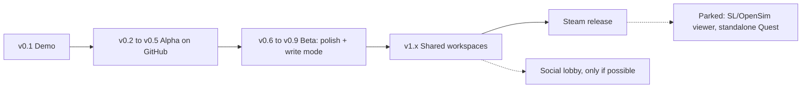

# Project Snow Crash: Roadmap, Licence and Contributing

*Drafted 11 Oct 2026. Order follows Bit's core objective: (1) walkable file explorer; (2) hope: multi-user workspace; (3) only if possible: a small, casual lobby. GitHub first, Steam eventually (Q24). Time estimates assume one part-time dev with AI help and will move.*

## Phase overview

---

## Phase 0: Design (now)
- [x] Core Q&A with Bit (Q1–Q37)
- [x] Design docs (this folder)
- [ ] Answers to OPEN_QUESTIONS.md top 10
- [ ] Name check (see open questions) and GitHub repo created

## Phase 1: Demo, `v0.1.0-demo` (≈10–12 weeks)
See DEMO_MVP_SPEC.md. One building in the install-folder world, tutorial, manual setup wizard, galleries with cycling canvases, one cinema with resume, basic bag and teleport, VR + flat. **Exit:** Bit walks her webrips folder happily; all acceptance criteria pass.

## Phase 2: Alpha on GitHub, `v0.2`–`v0.5` (≈4–6 months)
Public pre-releases, testers welcome, bugs expected.

| Version | Headline |
|---|---|
| **v0.2 "This PC"** | Real drives as buildings in the bare world; drive lobbies; hallway overflow; door thumbnails choice; room templates (gallery, cinema, mixed, storeroom) |
| **v0.3 "Shop"** | Games: Playnite, GOG Galaxy, Steam, Epic importers; shelves by platform; cases; box-art override; safe launching; app plaques from Start Menu |
| **v0.4 "Find it"** | Search (Everything SDK + index fallback); teleport/grab/walk; guided walk + path shortening; notifications + native file watcher |
| **v0.5 "Worlds"** | Museum Quad (first stock world), theme-pack loader + validator, music room, document/archive peeks, accessibility pass |

**Exit:** a stranger can install from GitHub, run the wizard and use it as a daily file viewer without reading a manual.

## Phase 3: Beta, `v0.6`–`v0.9` (≈3–4 months)
- Remaining stock worlds: Metaverse City, Island, Mansion
- **Write mode** (paid/donation unlock): move, copy, rename, delete to Recycle Bin, undo journal
- Windows Libraries import option; favourites shelf polish
- Performance tiers, quality presets, foveated rendering where supported
- Localisation framework; first translations from contributors
- Code signing for Windows builds (fewer antivirus false alarms)

## Phase 4: Shared workspaces, `v1.x` (hope; big)
Prerequisite: PRIVACY_SAFETY.md §7 checklist done.
- Invite-only workspace rooms (small, e.g. up to 8 people)
- Files from the **host's PC** (streamed) or a **shared cloud folder** (Q6)
- Simple avatars (Q7); voice chat; desks where each person works
- Consent/recording flow; hash-matching on share; reporting; host controls
- Networking: Godot's high-level multiplayer + a relay/signalling server (or WebRTC); host-authoritative
- Watch parties in the cinema (synced playback)

## Phase 5: Steam release
- Steam page, trailer, achievements (very light), Steam Workshop for theme packs (reviewed), Steam Input bindings
- Write-mode unlock as a DLC or supporter pack (see licence note)
- Decide the store name (see open questions)

## Phase 6: Only if possible: the social lobby
A small, casual PlayStation Home-style hangout: a lobby in the Metaverse City where friends meet and pop into each other's (shared) workspaces. Kept small by design. Same moderation rules as workspaces.

## Parked
- **Viewer for Second Life / OpenSim** (Q8: "maybe both", parked). Note: SL's viewer code is LGPL C++; integrating it with Godot would be a major separate project.
- **Standalone Quest build** (needs a different file access story; Android storage only).
- Messenger characters delivering notifications (easter egg).
- Live previews through doors.
- Voice search; hand-tracking-first controls.

---

## Licence recommendation

Bit wants the project **open to outside help, with her having final say** (Q25), and a **paid write-mode** unlock, and some content she'll never allow. Those are three different things, and they're handled by three different tools:

| Need | Tool |
|---|---|
| Others can read, use and improve the code | An open-source **licence** |
| Bit has final say on what goes in | **Governance**: she's the maintainer ("BDFL"); only maintainers merge; written in `GOVERNANCE.md` |
| The name and official builds stay hers | **Trademark/branding** policy: forks must rename |
| Some content is never allowed | **Code of conduct + content policy** for the project and official services (a licence can't restrict *use*, but the project controls what it accepts and hosts) |
| Paid write mode | Sell **official signed builds / a supporter key** for convenience and to say thanks (honest: with open code, people technically can unlock it themselves) |

### Recommended: **GPL-3.0-or-later** for code, **CC BY-SA 4.0** for our art/audio, plus a **DCO** sign-off

Why GPL-3.0:
- Anyone who forks and distributes Snow Crash must keep their version open too, so nobody can take the project closed and sell it as their own.
- Compatible with the pieces we plan to use: Godot (MIT), Godot XR Tools (MIT), godot-sqlite (MIT), FFmpeg-based plugins (LGPL; the GoZen repo's licence file is LGPL-2.1 **(verify)**).
- Selling GPL software is allowed; plenty of GPL games are on Steam.

Trade-off to know about: with GPL, a separate **closed-source** write-mode module isn't really possible. If Bit would rather keep write mode closed ("open core"), choose **MPL-2.0** for the core instead (file-level copyleft: our files stay open, but separate closed modules are allowed). That's the main fork in the road (open question #2).

**CLA or DCO?**
- **DCO** (Developer Certificate of Origin: contributors add `Signed-off-by`) is lightweight and friendly.
- A **CLA** additionally lets the maintainer **relicense** later (e.g. to dual-license or change to MPL). If Bit thinks she might ever want that flexibility, a simple CLA is worth it now; it's much harder to add later.
- Suggestion: DCO now, unless she says she wants relicensing freedom (open question).

### Third-party notes
- Everything (voidtools) is a separate program the user installs; we talk to it over IPC. Check the SDK's licence terms before bundling `Everything64.dll` **(verify)**.
- FFmpeg builds must ship their licence and (for LGPL) be dynamically linked and replaceable.
- Stock-world art should be original or CC0/CC BY with credits in About.

---

## CONTRIBUTING outline (to become `CONTRIBUTING.md`)

1. **Welcome**: what Snow Crash is, the pillars (DESIGN_OVERVIEW.md), and "Bit is the maintainer and has the final say; that's how we keep it coherent."
2. **Code of conduct**: link to `CODE_OF_CONDUCT.md` (Contributor Covenant 2.1 + the project's content policy: certain content is never accepted, anywhere).
3. **Before you start**: check issues; for anything bigger than a bug fix, open an issue or discussion first and wait for a thumbs-up from a maintainer.
4. **Setting up**: Godot version (pinned, e.g. 4.7.x), required addons, how to run in VR (Quest Link / SteamVR) and flat mode, how to run tests.
5. **Project structure**: `core/` (pure logic + tests), `autoload/`, `world/`, `ui/`, `themes/`, `addons/`, native GDExtension folder.
6. **Coding style**: GDScript style guide (official), static typing where practical, small scripts, signals over tight coupling, no file writes outside the app data folder (read-only rule!), comments explaining *why*.
7. **Tests**: new core logic needs tests (GUT/gdUnit4); performance-sensitive changes need a before/after frame-time note.
8. **Commits and PRs**: small PRs, descriptive titles, `Signed-off-by` (DCO), screenshots or short clips for anything visual, checklist (tested in VR? flat? Windows build?).
9. **Review**: at least one maintainer approval; Bit decides disputes; "no" sometimes means "not now".
10. **Theme packs and art**: pack format (WORLDS.md), licences (CC0/CC BY), budgets, no scripts.
11. **Translations**: how to add a language.
12. **Security and safety reports**: private email for vulnerabilities and safety issues; never post them in public issues.
13. **AI-assisted contributions**: welcome, but you must understand and test what you submit, and you're responsible for licence cleanliness (no pasted copyrighted code).
14. **Recognition**: contributors list in About and the README.
