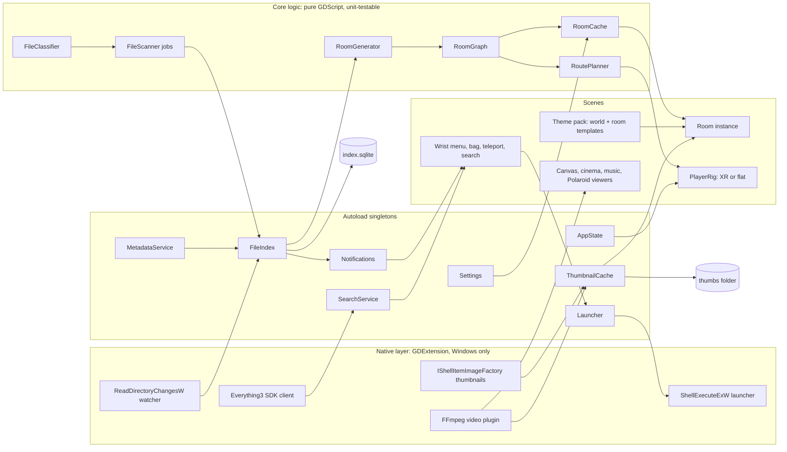

# Project Snow Crash: Technical Architecture

*Drafted 11 Oct 2026. Target: Windows 10/11 PC app, Godot 4 (4.7.x stable at time of writing) + OpenXR, played on Quest 2 via Quest Link / Air Link / Steam Link, plus a flat-screen mode. Anything marked **(verify)** is my best understanding and should be checked against current docs before code depends on it.*

---

## 1. Guiding technical rules

1. **Read-only by construction.** No code path in free mode opens a user file for writing. All app data lives in the app's own folders, never beside the user's files: settings, index and resume points in Godot's `user://` folder (`%APPDATA%\SnowCrash\` on Windows, because the project sets a custom user dir), and the bulky thumbnail cache in `%LOCALAPPDATA%\SnowCrash\thumbs\` (non-roaming). Write mode (later) goes through one audited module.
2. **Never block the frame.** In VR a dropped frame is felt, not seen. All disk I/O, image decoding, thumbnailing and database work happens on worker threads; the main thread only receives finished results via signals and a per-frame upload budget.
3. **Lazy everything.** Scan what you're about to see, not the whole disk. Load the room you're in plus the ones you're likely to enter next.
4. **Data first, scenes second.** The room generator turns folder data into a plain `RoomSpec` (data only), then a theme pack turns that into nodes. This keeps generation testable and makes worlds swappable.
5. **GDScript first, native only where needed.** Native (GDExtension, C++ or Rust via godot-rust) only for: Windows change notifications, Everything SDK, Windows shell thumbnails, `ShellExecuteEx` with a working directory, and video decoding (via an existing plugin).

---

## 2. Architecture diagram



---

## 3. Godot project structure

```
snowcrash/
├── project.godot
├── addons/
│   ├── godot-xr-tools/        # hands, pickup, teleport, snap turn, vignette (MIT)
│   ├── gde_gozen/             # or EIRTeam.FFmpeg: video decoding (see §8)
│   ├── godot-sqlite/          # index database (MIT)
│   └── snowcrash_native/      # our GDExtension: watcher, shell thumbs, launcher, Everything
├── autoload/                  # singletons registered in project.godot
│   ├── app_state.gd           # mode (VR/flat), current world, current room, write-mode flag
│   ├── settings.gd            # ConfigFile-backed settings + signals
│   ├── file_index.gd          # owns scanner jobs, the DB, change watching
│   ├── thumbnail_cache.gd
│   ├── notifications.gd
│   ├── metadata_service.gd    # launcher importers
│   ├── search_service.gd      # Everything adapter + fallback
│   └── launcher.gd            # safe open/launch
├── core/                      # no scene dependencies; testable headless
│   ├── file_scanner.gd
│   ├── file_classifier.gd
│   ├── room_spec.gd           # data classes: RoomSpec, DoorSpec, ItemSpec
│   ├── room_generator.gd
│   ├── room_graph.gd
│   ├── room_cache.gd
│   ├── route_planner.gd
│   └── importers/ (steam.gd, gog_galaxy.gd, playnite.gd, epic.gd)
├── player/
│   ├── player_rig.tscn/.gd    # switches XROrigin3D vs flat camera
│   ├── flat_controller.gd
│   └── hands/
├── ui/
│   ├── wrist_menu.tscn/.gd
│   ├── bag_menu.tscn/.gd
│   ├── teleport_menu.tscn/.gd
│   ├── search_panel.tscn/.gd
│   └── settings/
├── world/
│   ├── world_root.gd          # loads a theme pack, places buildings
│   ├── door.tscn/.gd          # portal door with label + thumbnail
│   ├── canvas.tscn/.gd        # cycling picture frame
│   ├── cinema/                # seat, screen, thumbnail wall
│   ├── shelf/                 # game cases
│   └── loot/                  # loot drop, themed object, Polaroid
├── themes/                    # built-in theme packs (same format as user packs, WORLDS.md)
│   ├── bare/  metacity/  museum/  island/  mansion/
├── tutorial/
└── tests/                     # GUT or gdUnit4 tests for core/
```

Rendering: start on the **Mobile** renderer (lighter, good for VR, plenty for simple graphics), with Forward+ as an option for high-end PCs. Enable OpenXR in Project Settings (`xr/openxr/enabled`, `xr/shaders/enabled`). Use **Godot XR Tools** for hands, pickup, teleport, snap turn and vignette rather than writing them from scratch.

VR vs flat: one `PlayerRig` scene. At startup, try `XRServer.find_interface("OpenXR").initialize()`. If it succeeds, enable the XR origin; otherwise (or if the user chose "desktop mode") use the flat camera with WASD. Every interaction goes through an abstract "pointer + grab + menu" input layer so that game logic never cares which rig is active.

---

## 4. File-system scanning and indexing service

### 4.1 Responsibilities
- Enumerate folders and files on demand, classify them, store results in a small index.
- Keep the index fresh via change notifications.
- Feed thumbnails and metadata.
- Never touch user files except to read them.

### 4.2 Scan strategy: shallow-first, deep in the background

| Job | When | Depth | Priority |
|---|---|---|---|
| **Room scan** | You're entering, or about to enter, a folder | 1 level: files + subfolder names + child counts | Highest |
| **Neighbour scan** | After a room scan, for each subfolder (door) | 1 level, counts only + pick a door thumbnail | High |
| **Library scan** | Wizard locations, favourites | Full recursive, throttled | Low |
| **Drive survey** | First run / per drive | Top 2 levels only | Low |

Implementation: `WorkerThreadPool.add_task()` (or a dedicated `Thread` with a job queue) runs `DirAccess` enumeration. Results come back as plain Dictionaries via `call_deferred()` / a thread-safe queue polled each frame. Jobs are cancellable (a generation counter: when you change direction, stale jobs are dropped).

Folders that can't be read (permissions, offline network share, unplugged USB) produce a **locked door** with a padlock and a reason, never a crash.

Skip by default (user-editable): `$Recycle.Bin`, `System Volume Information`, `Windows\WinSxS`, `node_modules`, `.git`, hidden + system attributes. "Show hidden files" in settings. Reparse points/junctions are followed once with a visited-set to avoid loops.

### 4.3 The index

SQLite via the godot-sqlite GDExtension, at `user://index.sqlite` (`%APPDATA%\SnowCrash\index.sqlite`).

```sql
folders(id, path UNIQUE, parent_id, name, mtime, child_folder_count,
        child_file_count, dominant_type, chosen_thumb_path, last_scanned)
files(id, folder_id, name, ext, size, mtime, kind, thumb_key, meta_json)
resume(path_hash, position_s, duration_s, updated)      -- film resume points
favourites(path, label, added)
games(id, source, source_id, title, platform, install_path,
      launch_uri, cover_path, meta_json)                 -- from importers
```

Keys are normalised (lower-case, backslashes) paths. If the DB is deleted, everything rebuilds. It's a cache, never a source of truth.

### 4.4 Change watcher

- **Native (preferred):** a tiny GDExtension wrapping `ReadDirectoryChangesW` on each drive root or watched folder (with `FILE_NOTIFY_CHANGE_FILE_NAME | DIR_NAME | LAST_WRITE`), on its own thread, coalescing bursts (e.g. a browser writing a download: create, many writes, rename) with a ~1.5 s debounce.
- **Fallback (GDScript, demo):** poll the mtime of the current room's folder, cached rooms and wizard locations every 3–5 s. Cheap and good enough for the demo.
- Events update the index, invalidate affected cached rooms, and raise a **notification** ("New file in Downloads: *Report.pdf*. View / Go there / Ignore"). If you're *in* the room, the new item appears with a gentle pop-in at the next free slot, or the room offers "Refresh room" if the layout would shift.

### 4.5 Thumbnail cache

Location: `%LOCALAPPDATA%\SnowCrash\thumbs\<aa>\<key>.webp`, where `key = hash(normalised_path + size + mtime + tier)`. A changed file gets a new key automatically.

Tiers: **128** (door labels, search results, video walls), **512** (canvases at distance), **full** (up to 2048 or 4096 on a long look or when held; never cached on disk, just loaded).

Generators, in order of preference:
1. **Godot `Image.load_from_file()`** for PNG, JPG, WebP, BMP, TGA, SVG (worker thread, resize, save as WebP).
2. **Windows shell thumbnails** (`IShellItemImageFactory::GetImage`) via the native layer for anything Windows can thumbnail: PDFs, PSDs (with codecs), HEIC (with the Microsoft extension), RAW, Office docs, videos. This gives us Explorer-quality thumbnails for free.
3. **Video frames** via the video plugin, or bundled `ffmpeg.exe -ss 00:00:10 -i file -frames:v 1` as a fallback (seek ~10% in to avoid black intro frames).
4. **Nothing works:** Polaroid (images) or loot drop (everything else).

A disk budget (default 2 GB, user-adjustable) with least-recently-used eviction.

---

## 5. Room generation

### 5.1 From folder to RoomSpec

```
FolderData (from index)
   │  classify files by kind; count subfolders
   ▼
choose template by dominant kind  →  gallery | cinema | arcade/shop | music | study | storeroom | mixed
   ▼
allocate items into "slots" the template offers (canvases, seats, shelf bays, plinths, crates)
   ▼
apply caps + overflow rules
   ▼
place doors (subfolders), back door (parent), side doors (overflow)
   ▼
RoomSpec { id, path, template, slots[], doors[], overflow[], ambient, seed }
```

The generator is **deterministic**: same folder contents + same settings + same theme = same room (a seed from the path hash). That means a room looks the same each visit even though it resets on exit, which helps people build a mental map.

### 5.2 Templates and dominant type

| Dominant content (by count, weighted) | Template | Notes |
|---|---|---|
| ≥ 60% images | **Gallery** | N canvases (default 12, theme decides 8–24) |
| ≥ 1 long video (> 20 min) or ≥ 60% video | **Cinema** | Seats, big screen, thumbnail wall |
| Detected game library | **Shop / arcade** | Shelves per platform |
| ≥ 60% audio | **Music room** | Record crates / jukebox |
| ≥ 60% documents | **Study** | Desk, filing cabinets, bookshelf |
| Mostly unknown / archives | **Storeroom** | Crates and loot drops |
| Mixed | **Mixed room** | Zones: wall art + TV corner + table + shelf |

Users can override the template per folder ("Make this a cinema") and it's remembered in the index.

### 5.3 Caps and overflow: keeping rooms bite-sized (the core rule)

Default caps per room (tunable per theme and in settings, "Room density: cosy / normal / roomy"):

| Thing | Cap | Overflow behaviour |
|---|---|---|
| Images | 12 canvases | **Cycling** (decided Q1): canvas *i* shows images *i, i+N, i+2N…*; slideshow 1–5 s or manual. A "contact sheet" lectern lets you browse/jump through all of them as a flat grid |
| Videos | 1 screen + thumbnail wall of 24 | Paged thumbnail wall (A–Z / date / size), not more rooms |
| Games | 6 shelf bays × ~40 cases | One bay per platform; a platform with more than one bay's worth (Bit's 512 PC games) gets its own **shelf wall** with sort + A–Z tabs, or its own side room |
| Audio | 1 jukebox + crates of 50 | Paged crates |
| Documents / unknown | 16 visible objects | Grouped into **one crate per type** ("37 PDFs") that opens a paged list in your hand |
| Doors (subfolders) | 8 | A **hallway door**: "More rooms (M–Z)" leading to a corridor with up to 12 more doors, split alphabetically (or by date for year-named folders). Recursive if needed |

Optional auto-grouping (setting, off by default in the demo): if a big image folder has clear date spread, offer "split by year" as virtual side rooms ("2024 photos"). These are *virtual* rooms: they don't exist on disk, are clearly labelled as filters, and never change files.

### 5.4 Doors and impossible space

Rooms don't need to fit together architecturally (decided Q30), which makes life much easier:

- Each room is built in its own **pocket**: a local origin far apart from others (e.g. spaced 1 km apart on X, or stacked), so rooms never physically overlap.
- A **door** is a pair of portal endpoints: door D in room A ↔ the "back door" in room B.
- Crossing a door's threshold (a thin Area3D) **instantly re-parents/transforms the player** to the matching point in room B, preserving their offset and facing. Because B is preloaded and the two doorways look identical from inside the frame, the swap is invisible.
- **v1:** doors are opaque (label + thumbnail on the door), they swing open as you approach (once B is ready) and you see a short, dim "vestibule" (a 1 m entrance alcove that both rooms share), which hides the swap. No portal rendering needed.
- **Later [MAYBE, Q31]:** a live view through an open door via a `SubViewport` camera rendered at low resolution, only for the nearest door, only on capable PCs. In VR this costs an extra stereo render, so it's opt-in.
- Detail scales with distance: far away a door shows just the name; nearer it shows the thumbnail, item counts ("214 images, 3 folders") and the last-modified date.

Door placement inside a room: the template defines door sockets along walls (e.g. 8). Subfolders are sorted (name / date / user choice) and fill sockets clockwise from the entrance. The back door (to the parent) is always directly behind your spawn point. Overflow hallway door is always the last socket.

### 5.5 The room graph

The folder tree *is* a graph (tree + virtual nodes for hallways and filters + "shortcut" edges). `RoomGraph` holds lightweight nodes: path, parent, child list, template, door socket assignments. It's cheap (no meshes) so we can keep thousands in memory.

### 5.6 Path shortening for guided walks (Q22)

A guided walk from room A to file F in room Z:

1. **Real route:** A → up to the lowest common ancestor → down to Z (tree path). Shown as a soft glowing ribbon on the floor and an arrow on the wrist.
2. **Shortened route (default on):** after each step, `RoutePlanner` checks whether the player can't see a door socket that's currently unused or about to be generated (outside the camera frustum and occluded, checked via the room's cell visibility list). If so, it **re-targets that door** to lead to the next-but-N room on the route (skipping intermediate rooms), or inserts a new "shortcut door" into a hidden socket. The world changes only out of sight.
3. Rules: never change a door the player is looking at or within 3 m of; never remove the way back (the back door always leads to the real parent); cap shortening so walks still feel like a journey (setting: "Shorten route: off / a bit / a lot").
4. **Toggle off:** you walk the true tree path. Treadmill users may want long walks; that's fine.
5. Arrival: the target object glows and plays a soft chime; the guide ribbon fades.

Teleport is simply "jump to room Z's spawn, facing the target".

---

## 6. Asset streaming, RAM/VRAM budget and the room cache

### 6.1 Where the budget lives
On Quest Link everything renders on the **PC**, so the budget is the PC's RAM and GPU VRAM, not the Quest's. Quest 2 renders roughly 1832 × 1920 per eye, so a canvas rarely needs more than 1024–2048 px.

### 6.2 Default budgets (settings → Performance)

| Setting | Low | Normal (default) | High |
|---|---|---|---|
| Rooms kept cached (Q33) | 1 | 3 | 6 |
| Texture budget (VRAM) | 512 MB | 1.5 GB | 3 GB |
| Canvas resolution | 512 | 1024 | 2048 |
| Next-image prefetch per canvas | 1 | 2 | 3 |
| Door previews | off | label + thumb | live (one door) |

Rough numbers: a 1024² RGBA8 texture with mipmaps ≈ 5.3 MB. A 12-canvas gallery with current + 2 prefetched images ≈ 190 MB. Fine.

### 6.3 Cache behaviour
- **States:** `UNLOADED` → `SPEC_READY` (data only, tiny) → `PRELOADED` (nodes built, thumbnails at 512) → `ACTIVE` (full-res as you look, video ready).
- **Prefetch:** when you enter room A, preload its 1–3 most likely next rooms (doors nearest your gaze/path, the back door, and the guided-walk next room).
- **Reset on exit (Q32):** when you leave a room, it drops back to `SPEC_READY` (or is evicted LRU if over the user's cache count). Canvas positions, slideshow position etc. reset. **Exception:** video playback position is saved to `resume` on pause, exit or every 10 s.
- **Upload throttle:** at most ~2–4 texture uploads per frame (`ImageTexture.create_from_image`, or `RenderingServer` with prepared images) to avoid hitches. Decode happens on threads; only the upload is on the main thread.
- **Pressure handling:** if VRAM/RAM estimates exceed budget, evict cached rooms first, then drop canvases to the 512 tier, then pause prefetch. Log it in a debug overlay.

---

## 7. Room reset, persistence and favourites
- Persisted: chosen door thumbnails, template overrides, favourites shelf, video resume points, settings, guest visibility rules.
- Not persisted: anything you moved in a room (no furniture rearranging in v1, Q23).

---

## 8. Video playback in Godot

Godot's built-in `VideoStreamPlayer` only plays **Ogg Theora**. Real libraries are MP4/MKV/WebM with H.264/H.265/VP9/AV1, so we need a plugin.

| Option | What it is | Pros | Cons |
|---|---|---|---|
| **GDE GoZen** (Voylin) | FFmpeg GDExtension, `VideoPlayback` node; Godot 4.3+; Windows/Linux/macOS/Android | Actively maintained (regular 2026 releases), seeking, playback speed, AV1/VP8/VP9 statically built, many formats | Compiled builds sold/donation-ware on itch/Ko-fi (source is open); check audio track handling and HW decode **(verify)** |
| **EIRTeam.FFmpeg** | FFmpeg-based `VideoStream` decoder for Godot 4.1+, MIT | Plugs into the standard `VideoStreamPlayer` | Building FFmpeg is documented for Linux/macOS hosts; fewer recent updates **(verify)** |
| **libmpv via GDExtension** | Embed mpv, render to texture | mpv handles basically everything, HW decode, subtitles | More integration work; community bindings vary in quality **(verify)** |
| **Native OS decoders** | A plugin using Windows Media Foundation for hardware H.264/HEVC (a "native video" plugin was reported for Godot 4.6+ on Windows/macOS) **(verify)** | Hardware decode, low CPU | Codec support depends on Windows codecs; MKV/AV1 patchy |
| **External player fallback** | Bag → "Open in VLC / default player" | Always works | Leaves VR |

**Recommendation:** prototype with **GoZen** (most active, simplest node API). Hide it behind our own `MediaPlayer` interface so we can swap to mpv later if 4K HEVC performance or subtitles demand it. Always keep "Open in default player" in the bag.

Cinema specifics:
- Default flow (Q3): you sit (seat snap point), the screen fades in the poster, the plugin opens and pre-buffers, and **only then** the Play button appears. A setting allows "play without sitting".
- Audio: `AudioStreamPlayer3D` at the screen (or 2D for "headphones mode"), with the plugin's audio routed to it **(verify the plugin's audio path)**.
- Subtitles: sidecar `.srt` / `.vtt` parsing in GDScript as a v2 feature; embedded subs depend on the plugin.
- Resume: position saved by path hash; on return, "Resume from 1:12:40 / Start over".
- Licensing: FFmpeg is LGPL (or GPL if built with GPL parts); bundle as a dynamic library and include the notice. H.264/HEVC patents are a grey area in some countries; we only decode files the user already has.

---

## 9. Launching apps and games safely on Windows

Launching is the one place a read-only app can still cause harm, so it's deliberately careful.

### 9.1 Rules
1. **Picking something up never launches it** (Q14). Launch is always a deliberate bag choice.
2. **First launch confirmation** per executable: "Run *Setup.exe*? This will open on your desktop." Remember "always allow" per path + hash.
3. **Mark-of-the-Web warning:** if the file has a `Zone.Identifier` alternate data stream with ZoneId 3 (downloaded from the internet), show an extra warning and let Windows SmartScreen do its job (use ShellExecute, which honours it).
4. **Script types** (`.bat .cmd .ps1 .vbs .js .wsf .hta .reg .msi .scr`) are *not* run from VR in free mode; the bag offers "Show in folder" instead. A settings toggle can allow them (with a warning).
5. **Never elevate ourselves.** If a program asks for admin, Windows shows UAC on the *desktop*, not in the headset. We detect the request (`requireAdministrator` manifest or `ERROR_ELEVATION_REQUIRED`) and tell the user: "This needs admin. Check your desktop / Link desktop view."
6. **Prefer launcher URIs for games** so DRM, overlays, cloud saves and playtime tracking all work:
   - Steam: `steam://rungameid/<appid>`
   - Epic: `com.epicgames.launcher://apps/<AppName>?action=launch&silent=true`
   - GOG Galaxy: `GalaxyClient.exe /command=runGame /gameId=<id> /path="<install>"` **(verify flags)**
   - Playnite: `playnite://playnite/start/<game-guid>` (lets Playnite handle emulators too)
   - Emulated games without Playnite: a user-configured emulator command line per platform, e.g. `"C:\Emu\pcsx2.exe" "{rom}"`.
7. **Working directory:** many old games break if not launched from their own folder. Godot's `OS.create_process()` has no working-directory parameter, so the native layer exposes `ShellExecuteExW` with `lpDirectory` = the exe's folder. Demo fallback: `OS.shell_open(path)` (ShellExecute "open" with Explorer's defaults).
8. **Documents and unknown files:** "Open in Windows" = `OS.shell_open(path)` (the default handler). "Show in folder" = `OS.shell_show_in_file_manager(path)`.
9. **What happens in the headset:** after launch, the world dims and the wrist shows "Launched *X* on your desktop" with tips (Link desktop view / take the headset off). VR games launched from inside VR may fight over the OpenXR runtime: we offer "Pause Snow Crash's VR while this runs" which releases the XR session **(verify how Quest Link handles handover)**.

---

## 10. Metadata importers (games, Q13)

All importers are **read-only**, copy the DB to a temp file first (launchers may hold locks), and degrade gracefully if a launcher isn't installed or its format changed. Each produces `GameRecord { title, platform, source, source_id, install_path, launch_uri, cover_image, hero_image, description, genres, playtime, last_played }`.

| Source | Where | Format | Notes |
|---|---|---|---|
| **Playnite** (best single source: aggregates Steam/GOG/Epic/emulators) | `%APPDATA%\Playnite\library\` (installed) or `<Playnite>\library\` (portable); actual path in Playnite's `config.json` | Directory-based database: `games\` (one JSON-ish file per game), plus `platforms\`, `genres\`, `tags\`, and `files\` for covers/backgrounds **(verify exact serialization for the current version)** | Platform names map straight onto our shelves. Covers live in `files\<game-guid>\` |
| **GOG Galaxy 2.0** | `C:\ProgramData\GOG.com\Galaxy\storage\galaxy-2.0.db` | SQLite. Key tables: `GamePieces` + `GamePieceTypes` (title, originalImages JSON with vertical cover URL), `LibraryReleases`, `InstalledBaseProducts`, `PlayTasks` / `PlayTaskLaunchParameters` | Galaxy also aggregates other platforms via integrations (`releaseKey` prefixes like `steam_`, `epic_`, `gog_`). Images may be URLs; cache locally |
| **Steam** | `<Steam>\steamapps\libraryfolders.vdf` → each library's `appmanifest_<id>.acf`; art in `<Steam>\appcache\librarycache\` | Valve KeyValues text (simple to parse) | Covers: `<appid>_library_600x900.jpg` (older layout) or `<appid>\library_600x900.jpg` (newer layout); check both **(verify)** |
| **Epic** | `C:\ProgramData\Epic\EpicGamesLauncher\Data\Manifests\*.item` | JSON: `DisplayName`, `AppName`, `InstallLocation`, `LaunchExecutable` | No local box art reliably; use the exe icon or an online source later |
| **Emulator folders** | User-picked folders, e.g. `D:\Roms\PS2` | Folder name → platform via a lookup table (PSX/PS1, PS2, Xbox, X360, N64, SNES…) | Covers from a `covers\` subfolder, Playnite, or the user's own choice |
| **Others (later)** | EA app, Ubisoft Connect, Battle.net, itch, Amazon | Varies | Playnite/Galaxy usually already cover these; don't write our own unless asked |

Merge rules: dedupe by (normalised title + platform) and by install path; priority Playnite > GOG Galaxy > native launcher > folder scan; the user's manual override (box art, title, platform) always wins and is stored in our DB.

Apps (harder, as Bit noted): use the Start Menu shortcuts (`%ProgramData%\Microsoft\Windows\Start Menu\Programs` and the per-user one), resolve `.lnk` targets, take icons from the exe at 256 px via the shell, and let the user pin favourites in the wizard. Online box art for apps is out of scope.

Online metadata (IGDB/SteamGridDB) is **optional, off by default**, and needs explicit consent because it sends titles off the PC.

---

## 11. Search: Everything SDK integration (Q22)

### 11.1 Options

| Route | How | Speed | Effort |
|---|---|---|---|
| **Everything 1.5: SDK3** | Named pipe `\\.\PIPE\Everything IPC` (or `... (1.5a)` for the alpha instance), C API `Everything3_ConnectW / Everything3_Search` | Instant, whole PC | GDExtension (small C++ wrapper) |
| **Everything 1.4: SDK2** | `Everything64.dll` window-message IPC: `Everything_SetSearchW`, `Everything_QueryW` | Instant | Same wrapper, different calls |
| **`es.exe` CLI** | `OS.execute("es.exe", ["-n", "50", "-full-path-and-name", query], output)` on a worker thread | ~50–150 ms per query | Pure GDScript, great for the demo |
| **Our own index** | Query `index.sqlite` (only scanned places) | Fast but incomplete | Already have it |

**Plan:** demo uses our own index (only wizard locations) + `es.exe` if found. Alpha adds the native SDK3 client with SDK2 fallback, trying the default instance then `1.5a`. If Everything isn't installed, the search panel offers a one-line explanation and a link to voidtools (we don't bundle it without checking its licence terms **(verify)**).

### 11.2 Search flow
1. Wrist → Search → type (virtual keyboard), dictate (later), or pick a filter chip (Pictures / Videos / Games / This room / This drive).
2. Results stream into a scrollable list with 128 px thumbnails and paths, capped at 200.
3. Each result: **Teleport** (jump to its room, facing it, it glows) · **Grab** (it lands in the bag as a held reference, like copy-to-clipboard; nothing else happens) · **Walk there** (guided walk with optional path shortening).
4. Results respect guest visibility: in a shared session, guests only ever get results from rooms the owner opened.

---

## 12. Notifications
`Notifications` autoload keeps a queue (max 50, collapsible: "12 new files in Downloads"). The wrist panel shows a badge; tapping opens the list. Each notification: **View** (preview in hand), **Go there** (teleport), **Ignore**. Do-not-disturb toggle; the cinema auto-mutes notifications while a film plays.

---

## 13. Settings storage
`ConfigFile` at `user://settings.cfg` (`%APPDATA%\SnowCrash\settings.cfg`), grouped by section (general, comfort, controls, audio, video, performance, privacy, search, launchers). The full tree is in UX_CONTROLS.md.

---

## 14. Write mode (later, paid)
One module, `FileOps`, behind a licence check:
- Uses Windows `IFileOperation` (native) so moves and deletes go to the **Recycle Bin** and show Windows' own conflict dialogs where needed.
- Every action is logged in an **undo journal**; "Undo last" is on the wrist.
- Destructive actions need a two-step confirm in VR (hold to confirm).
- Never operates on system folders (Windows, Program Files) without an extra "I know what I'm doing" switch.
- Licence check is honest and light (see ROADMAP.md: open source means people *can* unlock it themselves; the paid key is a "thank you" and convenience).

---

## 15. Testing
- `core/` is scene-free so it can be unit-tested headless (GUT or gdUnit4): classifier tables, room generator caps/overflow, route planner, importer parsers (with fixture files).
- A **fake file system** generator (`tests/make_fixture_tree.gd`) builds test trees: 500 images, 40 subfolders, deep nesting, weird Unicode names, 260+ char paths, locked folders.
- Performance test scene: walk a scripted path through 20 rooms, log frame times; target 72/80/90 Hz with zero frames over 11 ms on a mid-range GPU (RTX 3060-class).

---

## 16. Known risks
| Risk | Mitigation |
|---|---|
| Video plugin quality/licensing | Abstraction layer; external player fallback |
| Hitches when entering big rooms | Preload, upload throttling, vestibules hiding swaps |
| Long paths (> 260 chars) and odd Unicode | Use `\\?\` prefixed paths in native code; test fixtures |
| Network drives/NAS being slow | Mark as "remote building", lower scan priority, show a loading doorway |
| Launcher DB formats change | Each importer versioned, fails soft, Playnite-first |
| VR game launched from VR fights over OpenXR | "Release VR while app runs" option |
| Antivirus flags the native watcher/launcher | Sign releases (later), keep native code small and open |
